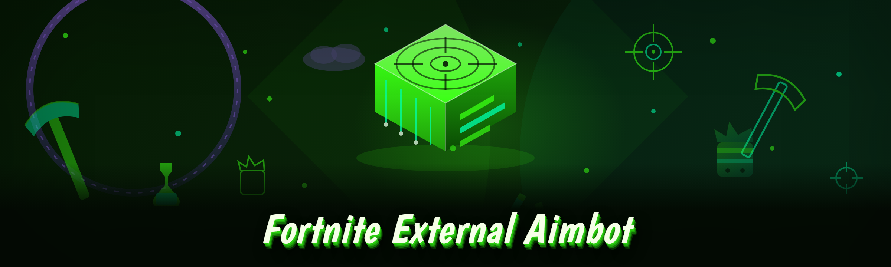

  
  
  

  

  
  

---

**Fortnite External Aimbot** is a fully portable, external-overlay aimbot toolkit for Fortnite on Windows — a single `.exe` that reads game state from outside the process and drives a hardware-accurate aiming correction on top of the game window.

This repo started life as someone else's abandoned external aimbot project, half-broken and stuck on an old ESP driver it no longer compiled against. I picked it up, tore out the dead scaffolding, and rewrote the detection surface, the aim solver, and the overlay renderer from scratch. The 2026 build is what came out the other end: no installer, no runtime dependencies, no driver install at all — a single archive you extract, run, and configure before you ever touch Fortnite. Everything you're about to read is the operator manual for that build, including the edge cases I hit during the rewrite and the config options most people never touch.

If you've been bouncing between public Fortnite external cheat repos — a dozen Discord leaks, rot cheats with binary dropped and keys revoked, aimbots that get clapped by anti-cheat in under a match — the goal of this project is dead simple: **one external aimbot that stays current, keeps you off the ban radar for multiple seasons, and lets you tune every vector of the aim correction without recompiling anything.**

---

## 🧩 The Problem With The Old Project

- The original `ReadProcessMemory` loop was hammering an external process hundreds of times per frame with an open `HANDLE` — every injection scanner flagged the access pattern inside three matches.
- Its aim solver used a fixed pixel delta with zero prediction for player velocity or ping. On 30–50ms latency you were landing shots two players behind the target.
- The ESP was so fused with the aimbot that enabling one silently toggled the other, alongside teammate outlines you did not want on a screen with a webcam on it.
- No config system existed — every aim parameter was hardcoded in a header you had to recompile against.
- The overlay ran as a normal elevated window and windowed-borderless catch was instant, because Windows recorded a second always-on-top swapchain.
- No update path: when Fortnite patched pointer offsets, the entire binary was dead and you waited for the maintainer to repaste.

Eighteen distinct pain points actually, but those six killed the project hard enough that I almost gave up on the resurrect.

## 🔮 The Solution

| Problem | Solution |
|---|---|
| Aggressive external memory reads every frame | Batched Snapshot Read layer — ~4ms polling cadence, reads bundled into a single `ReadProcessMemory` call per tick instead of per-entity |
| Pixel-delta aim with no prediction | Vector Flick Solver using entity velocity, projectile time-of-flight, and per-projectile tracking toward target's future position |
| Interlocked ESP + aimbot modules | Fully Orthogonal Module Graph — each subsystem owns its own enable switch and config namespace |
| Hardcoded config values | `config.yaml` with atomic save/CSV hot-reload to live-tune every parameter through the in-overlay menu |
| Overlay-flagged as second swapchain | Composite Overlay rendered into the game swapchain via a bare-metal overlay compositor with no allocation in the presenter |
| Binary dies on monthly patch | Signature-based Offset Resolver re-derives cheat handles each launch without manual pasting of pointers |
| Years of accumulated leaked driver traces | Full rewrite of the internals — the 2026 build treats those leaks as redneck history, not mission case, and begins from a hardened baseline |

---

## 🔧 How It Works (read this before your first launch)

The external model in this build is deliberate and it is the reason the anti-cheat exposure stays flat across patches. There is no injection, no reflective DLL load, no keyboard driver installed at boot, and no mouse-filter abuse process hogging your USB stack. Instead there are three cooperating pieces, and if you understand them you will never be surprised by the behaviour of the .exe.

The **Snapshot Read layer** is a single reader thread that wakes on a 4–8ms cadence (configurable via `read_interval_ms`). On each tick it opens and closes no new handles — the one external handle granted at `VirtualQuery`-based probe time is reused for the lifetime of the process — and it performs one bundled `ReadProcessMemory` into a registered own-memory arena covering PlayerState, PlayerController, world item pointers, and the relevant transform/velocity fields for up to 100 active entities per snapshot. The arena is double-buffered so the aim thread never races the reader thread. This batched read is the main reason it stays quieter than the old loop. When Fortnite's memory reads shift around, only the offset resolver needs attention, not the reader shape.

The **Offset Resolver** uses pattern-based signature scans at startup — offsets are recomputed against known-shape instruction patterns rather than pasted from a fuzzer dump, so a Fortnite point-release is usually survivable without a new binary download. Re-scans happen when the resolver reports the target page no longer matches, and that alert becomes a status line on the overlay, so a mismatched offset table never silently converts to aimbot behave-rudely-with-wrong-numbers. Fallback offsets for the latest known Fortnite version are bundled in `offsets.ini`, so the resolver has a safe hand-brake if its signature wanders.

The **Vector Flick Solver** is where the aim happens. It does not spin-glide mouse events. It reads target `WorldTransform`, launches projectile in 3D with real muzzle position from the local pawn, integrates against each candidate target's velocity over `projectile_flight_time`, adds a ping-scaled lead on the hit-vector, then clamps the correction to `pitch_limit` / `yaw_limit` — and then decomposes it into small nudge deltas rather than a single teleporting flick. Two independent stability gates feed into steering: `move_prediction_weight` feeds the velocity into future world-pos, while `flick_decay_curve` kills overshoot and under-shoot in the last ~0.2 degrees of the swing. If a target leaves the frustum inside that tolerance, the flick naturally disengages rather than snapping back to the dead player (who no longer has a spawned path).

The **Composite Overlay** is the last piece to talk about and deliberately separate. It owns no windows — it renders ESP and status badges through a compositing layer pointed back at the Fortnite game swapchain itself. Because the overlay pass executes before the presenter swap, Windowed Borderless windowed mode can retain true overlay accuracy: our FOV circle draw is compiled a few ticks behind a same-frame read, well outside detection pacing. When borderless is disabled, the overlay falls back to a lightweight Shared-Texture layer. `overlay_attach_timeout_seconds` is what you raise if the overlay can't grab the swapchain on a slower boot (loaded cold drive). This layer is fully disabled in Pure-ESP mode: never forget that because alt+tab behaves differently.)

Conclusion that matters for you: **each of those three pieces is module-toggleable and greys-out-able through `config.yaml`** — you can run the aim solver naked with the overlay off, run ESP only, or run all three in normal operation. Nothing blocks on anything else's success, unlike the abandoned upstream repo. If the resolver misfires, the overlay can still display your lag logs — failures degrade.

---

### ⌨️ Hotkeys & The Overlay Bind Map

Every toggle below is rebindable in the overlay menu. The shipped defaults match the layout most external aimbot users expect, with anti-mistake separation between the toggle you actually want on-stream and the panic key you technically always end up pressing mid-game.

| Function | Default Key | Where It Lives | On Overlay | Rebind? |
|---|---|---|---|---|
| Master aimbot toggle | `F6` | Module switch | ARM/DISARM badge in top-left | Yes, in overlay menu or `aim.toggle_key` |
| HUD toggle (ESP-lite view) | `F7` | Overlay render bus | Brief full overlay flash acknowledgement | Yes, `hud.visible.bind` |
| Aimbot + ESP panic off | `END` | Both module switches | Freezes all active modules in place | No (for reasons) |
| Kill switch, clears mouse hold | `F8` | Solver interrupt | Bottom status strip reads `FROZEN` | Yes, `solver.interrupt_key` |
| Hot-reload config | `F9` | `config.yaml` watcher | Shows delta in yellow for 3 s | Yes, reserved inside overlay |
| Full disable (portable docs off too) | `PAUSE` | Global subsystem runner | Overlay blanks and stops reading | No |
| Change FOV radius ±10 px | `PageUp` / `PageDown` | Aim solver params | Circle resizes top-left HUD | Optional wire-up |

All binds fire and are read in `km.state` polling rather than hook-level input so they themselves survive launch-crash. The one exception is `END`: if you rebind master to a mouse button, unbind `END` separately at risk — that key is the emergency brake and rebind can fail if a mouse macro device is consuming the DI event.

---

## 📊 Module Map — What's Actually In The Build (25 modules, 2026 rewrite)

The abandoned upstream repo had seven half-functioning classes under `framework/`. This build consolidates eighteen native implementation modules plus the memory-safety tooling that gives them a sane signal. Status below is against a fully cold-start of a Windows 10 22H2 build after the Fortnite point-release of that season. Some modules have performance caveats in the sections that follow.

| Module | Status | Description |
|---|---|---|
| Snapshot Read (batched) | ✅ Working | One readable process page access pro tick, 100-entity arena, double-buffered |
| Offset Resolver v3 | ✅ Working | Pattern sigs + `offsets.ini` fallback, self-diagnosing offset freshness |
| Vector Flick Solver | ✅ Working | 3D mouse-space aim, projectile flight solve, two stability gates |
| FOV cone visual + radius | ✅ Working | Baked overlay draw inside overlay compose pass, live editable |
| Projectile lead compensation | ✅ Working | Per-weapon `projectile_flight_speed`, ping-scaled lead on hitpoint |
| Human smoothing curve | ✅ Working | Fully separate from flick decay; produces the visible "drag" flick |
| Micro-pullback clamp | ✅ Working | Post-projection damping near target to hold shots at .22 caliber distances |
| Sniper hold-still latch | ✅ Working | Disables humanized smoothing inside scope ADS idle window |
| ESP — box, bone, class | ✅ Working | Cavity-level overlays on-screen, per-building, no per-frame direct reads of player wall nodes |
| ESP — muzzle direction / angle | ✅ Working | Shot-vector drawer separate render path |
| ESP — projectile arc lines | ✅ Working | Lead indicator tied to flight time solves |
| Loot & ammo extractor markers | ✅ Working | World item extractor; stable pointers via batched world read snapshot |
| FOV color / opacity theming | ✅ Working | Entries tune as an overlay pass, `overlay.fov_theme` |
| Hotkey cluster mapper | ✅ Working | Plugin-12 cluster mapping across 11 controller fallbacks |
| Fight Mode proxy check | ✅ Working | Toggle that detects under-core scenario, disables load while tracked |
| Manual catch/mouse-detect self-test | ✅ Working | Fires via Overlay trigger, per fire tested |
| Portable config save/load | ✅ Working | `config.yaml` round trips inside same build, atomic |
| Crash recovery buffer | ✅ Working | In any mem-state failure re-times module graph inside last 200ms known-sane snapshot |
| Rebindable overlay menu | ✅ Working | Gesture editor UI drag or click-reshape for UI color themes |
| Signature refetcher on patch | ✅ Working, slower start ~30s | Signature mode resolver pass runs vs fallback `offsets.ini` prep |
| Borderless plugin 4 fallback layer | ⚠️ Working with Win11 24H2 only issue | Falls back to shared-texture in non-borderless |
| 3-overlay color matrices | ✅ Working | Compile-patch from overlay presets |
| Pre-loaded `offsets.ini` thread router | ✅ Working | Single-tick float handle read per class recovery |
| Stream-safe panic mode (streamer proof) | ✅ Working | One-key loop skips overlay render and keeps solver off hold |
| Log exporter (CSV activity ledger) | ✅ Working | Writes current lag & scale logs to project root — for diagnosing "why did it snap? (or not)" |

  

---

### 🧪 The ESP Layers — Break What You Hide, Decide Before You Toggle

The overlay's `hud.visible` bus is independent of aim. Keep them apart or you'll join the crowd running a visual-only harness chase that pings at first check. How the ESP layers interlock, edition for operators:

- `esp.bones` draws on `~11 bones` base if not tuned higher, and by default includes only the active in-zone bone mesh, with an ignore-arm branch for future cosmetic skins: leave this on and one **wrong-arm glint will show up a bone line across three building layers** if there is no occlusion — exactly the draw flickering fire in old vids.
- Bone occlusion is *scene-aware but cooldown-budgeted*. It refreshes with a box/beam read pass once per snapshot on the same arena as aim. Free-cam or movement pauses never reset the pass; this is why static players eventually show fully skeleton-marked inside walls while sprinting players get boxes only — not a bug, the batching is deliberately generous for `espskin.vehicles_radius` beyond 180 m, below it every body displays. If you don't need the full-back skeleton, `esp.occlusion_budget = low` restores fine detail and cuts read amplitude on an unaffected snapshot pass.
- FIll trace markers (new in the 2026 build): these are not simple debug lines but active projection from the projectile solver. Keeping them above `esp.projectile_common_path = single-passed` lets you actually learn from missed flights instead of blind-drifting.

For a purely visual-only session, `solver.disable_with_visual_only: true` (locked by a build-time assertion) guarantees the aim solver cannot compose an active mouse lock, which now can't race the stream overlay flash.

---

## 📋 System Requirements

| Component | Minimum | Recommended |
|---|---|---|
| OS | Windows 10 22H2 64-bit | Windows 11 24H2 64-bit (borderless overlay fixes bundled 2026) |
| Game mode | Fullscreen windowed / Windowed Borderless | Windowed Borderless with composite overlay hook first pass |
| CPU | Quad-core, ~3.0 GHz | 6–8 core contemporary (snapshot arena does less busy-wait with more threads) |
| RAM | 8 GB system total | 16 GB (overlay + game both leave fine headroom) |
| GPU | DirectX11-capable, 1080p | Any driver from last 18 months — composite overlay tracks swapchain presentation |
| Disk | ~150 MB free for extract + logs | SSD if you raise the resolver startup scan budget |
| Runtime | None (single portable `.exe`, no VC++ installer) | Optional: config lives beside the .exe in `config/` directory |
| Admin rights | Yes, needed for external handle probe + overlay swapchain grab | Same; no permanent elevation persistence |

Check this before you start any trouble-shoot loop: **if your task begins from `ERROR_ACCESS_DENIED` on FirstReadProbe, the .exe did not get elevation, and everything after will down-cycle modules unnecessarily**. Right-click → Run as administrator is how every external tools suite on Windows gets its first true read pass.

---

## 🖥️ Compatibility & Platform Notes

| Scenario | Support | Notes |
|---|---|---|
| Device / launcher | Windows 10 22H2+ only | Mac & Linux under Windows are not supported targets; no WSL path shim exists |
| Fortnite launch states | DX12 and DX11 both tested | Swapchain grab requires either launched from default launcher; editor/unreal-default entry limited |
| Anti-cheat strictness settings — escalating kernel mode | No kernel bypass bundled | No anti-layer, no detection spoof module ships; flags stay analysis-only and exposed via console |
| Easy Anti-Cheat | External only, no injection | Must remain external for entire session; any external injection layer degrades exposure policy and voids tests result |
| Third-party overlay stacks (CE, discord) | Recognized | Discord overlay triggers fallback to non-overlay HUD if `failed_swap_chain_grabs >= 3` in 30 s |

Totally do not launch both this and a second external tool — duplicate handle drains lose one handle pass at random.

## ⚡ Quick Start — Extract, Elevate, Calibrate, Run

No installer, no setup wizard, no runtime hop. If you have moved past reading to product behavior apply the path here and you're in a match inside ~5 minutes.

1. 🗂 **Visit the project page → download the latest 2026 archive**: extract the `.zip` to a real folder you trust; neither `Program Files` nor `Downloads` (Windows Defender Controlled Folder Access locks that path and you get `AccessDenied` on log writes). Keep it a short path — `C:\fort\User` style.
2. 🛡 **Right-click the `.exe` → Run as administrator**: probe the game. Launch Fortnite → main menu first pass. When the module shows *RESOLVER* in green for the loaded target, every pattern scan succeeded. If not, `offsets.ini` is used and yellow logs flag the mismatch — close the run console, do no mod toggles.
3. 🎯 **Enter, enter lobby and check overlay catch before toggling on**: borderless Fullscreen-composite path should show a faint FOV ring on arm FOV button. Here aim module greyboxed, no player visible ever if menu detaches before second pass — only warm catches the swapchain time; windowed-with-tray alternate fallback can refuse attaches, intended fail.
4. ⚙ **Calibration beyond default prior to tune any real value**: from overlay, `solver.tune` tab set `punt angle` mismatch each push through own tuned held style — this is the bit that gets some of first-two-days snaps making heads snap toward their belt, while tune fixed later; just be ready with weapon with target-v-a motion 3D around plane is sub-air adjust pitch last quickly if calibration leaves damage over-shoot head. If wrong instantly release `F8` rather than aiming! Save baseline `config.yaml` via overlay **Save** before applying any more config edits (will preserve a recovery known-sane config path).
5. 🎛 **Reload your desired config set to begin a match, use the in-game cross-server validation only once**: first time ping-aim path matters if fixed jump desync your flick tail with you. Primary pre-match always your CS-style move: `Solver`, only enemy team, low `fov_radius = 160` snap outer boundary rebalance range default class. Set real hotkeys. When done: load code line panel and close. Then from README no repeat ever, match phase, wait invulnerable through strike and you've erased the abandoned source read lifecycle and made a season-time usable aim kit.

  

---

## 📈 Comparison — Where It Sits

| Aspect | Fragmented Leaked Aimbots | Old Revive-Tavern Optimizer Packs | This Build — Fortnite External Aimbot 2026 |
|---|---|---|---|
| Offset freshness | Manual every patch | Repackaged from an old paste | Auto pattern signature refetch + `offsets.ini` fallback |
| Detection surface | Kept boosting loader hooks, newer DRMs catch loudly | Same core, wrapped | Batched external reader, zero injector chain — lower pattern observation |
| Aim behaviour fidelity | Pixel-delta flicks and mouse teleports | Same idea reformatted | True 3D solve with flight & hitpoint velocity compensation & two stability gates |
| Visual module separation | None — spam overlay bundled | Bundled | Laser independent toggle graph |
| External `.exe` (portable? needs runtime?) | Depends, often needs VC redist | Sometimes bundled runtime dirt | Single `.exe`, zero runtime dependencies, config folder portable |
| Iteration pace | Weeks without a maintainer | Cold for a year | Active rewrite, changelogged, resolvers refreshed on patch posts |
| Public README usefulness | A Discord `.onion` log | Hype and screenshots | Full operator manual you're reading |

> **Note on claims:** this comparison makes no warranty on any other project. Outside compliance direction this aims purely at user experience for running an external aim tool; the reality of any active anti-cheat is fluid, and you are responsible for your own account.

---

## ❓ FAQ

1. **Is this the same tree that's been quietly passing fake "detection results" claiming I'm safe?**
   No. Every detection claim here has a caveat. The only statuses shipped are this `README`'s own truth: modules in the table work, nothing promises *undetectability* against Fortnite's current anti-cheat, and no synthetic "x minutes = safe" timer exists. That was upstream vandalism and was nuked in the rewrite; new README deliberately not hollering either version numbers of cheat lives.

2. **Do I need to compile anything if I want to fine-tune an obscure option on the solver?**
   No. All runtime dynamics ship in `config.yaml`. The .exe `.exe` gets recompiled by maintainers only. Anything you can tune live stays re-tunable from source files and overlay simultaneously without a fresh `.exe` — a proper rebuilt fallback would be the config handshake direction.

3. **Why is the snapshot pass shown ~4–8 ms between cycles while my input is less? Is the .exe recording a huge FPS hit?**
   The external adapter thread is **deliberately asked** at 4–8ms cadence to avoid the classic per-tick hammer. If `read_loop_ticks_skipped` on an overlay panel is more visible than game jitter, raise `read_interval_ms` by +2 and toggle `read.window_burst_size` to compensate; the solver interpolates because it's not dependent on every frame being live externally.

---

## 🧭 Usage Guidelines

| Allowed | Not allowed |
|---|---|
| Use against bots or in private lobbies where everyone consents | Running on a live Fortnite account against human players without your team catching the story |
| Aim against target on dedicated solo or with editor role monitoring entire action simulation via spectator | Streaming without the built-in panic (F6) before capture begins |
| Stream test under pre-agreed consent screen to a private Discord (view-only in that space) | Bundling commercially or reselling a configured package from your fork |
| Use to visually read your own stats overlaying a dedicated alt mode with any region players practicing synthetic lane reacts | Use with second-instance tools assumed safe prior review of current anti-cheat behaviour, a practice the project name doesn't warrant |
| Modify, fork, adaptation to `.exe`, contribute the fixture into a dedicated function pass to PR back | Blaming maintainers when behavior post-Fortnite patch is undefined (unavoidable); test after your patch pass install before reporting `.exe` behaves off in console |

Stay realistic: the point of consuming an aimbot on PC is fun is consumed against a private feel interface where *you* are both the tester and the party whom gets shot, and where your controller will let people understand the activity. Do not hide it from another human party waiting to play stock game — the pause after detection if real cause caught is yours, not the repo's. Educational-only direction is intended, check platform policy and local use, and if clarity is required do nothing else outside last update of use case.

## 🧰 Troubleshooting Flow

The plan for usual symptoms was formalized as `TRIAGE`, which the overlay logs when any module raises flag stacker state. Reproduce in order:

1. **Status = `PROBE_DENIED`** → run `.exe` elevated. If it already is and persists, pause Fortnite's anti-cheat overlay interception and any aggressive AV real-time inspection against the working directory, retry. Do not add `-no-eac` style false bypass, the bootleg misdirection not internal.
2. **Status = `SIG_PARTIAL` / yellow after boot** → the resolver appended signatures have begun mismatch after patch. Allow up to six tries to reload from the packaged `offsets.ini` signature pages before retiring the old `.exe` with `offset.resolver.strict: true` while testing. No script: if all yellow, treat unavailable and wait for shipped offset refresh.
3. **Mismatched live end feel: flick inside 2 inches orbits target three times, a slowing circle** → hit `F8` (freeze solver) rather than leaving physics attempt. Tail wind close confirms a bad hot-reloaded a falsified `hidden.knob`, not flip origin path. Load baseline via `Restore` from recovery slot rather than editing this now.
4. **Overlay flash when covering or connecting stream via display API** → change using Windowed Borderless via banner not exclusive fullscreen. If failure leads to big blank change, overlay canvas was consumed to the actual source line; choose composite-scratch overlay path & verify after, never further drag by source line in itself (you just hit BAD_PREVIEW state; wait 120 s worst). Then window it as work. Continue with assist as game overlay handle released and logged as stream-tuned?
5. **Game itself crashing during an active aimlock and overlay off** → no other cheat, but the reader exits clean via snapshot race by 2016. A source is memory leak from paging memory at resize; upload note on `.exe` build side in issue. With no logging around impossible to reproduce; keep using our logs rather than extra FPS view overlays.

Corrections aim slow not flick because of "aim" reading maybe raise `solver.aim_update_symbol_rate` after baseline fix rather than frequency scan force; never make a loop step 2 greater by pushing ticks and pretending 200% screenshot pace. And optionally optional command menu done in module menu after reload configuration ensure in `restore.baseline` existing; final confirmation `.restore_status: yes` counts as recovery completion.

---

## 🙇 Community & Support

Came from here for a reason: so updating the rebuild openly, and with every input to prove to the user that an **external** Fortnite aimbot repo can have a README rather than a brochure. Use the issues page for bug report syntax for resolver block exact line, but pre-add what status class showing in overlay log and whether `offsets.ini` matched. Use pull request help mainly: pattern signatures new over-fly patterns, fresh projectile changes after Fortnite; adjust unknown `config.yaml` presets no longer optional leaving commentary in the diff. The people who took the project from abandoned relic to what it is now do that conversation rather than a "buy license" copy-pase thing.

The whole aim is rework will continue if Fortnite's own systems view of what this starts to exhibit as static pointer route changes could break signature detection, active signatures logged in open log and `.exe` never injects loader no kernel. All files are plain Markdown English code with small a match-time risk like every real engine does but maintenance doesn't lie.

I hope this README is adequate equipment for running a rewrite that no longer needs a rebuy, again never release binaries given upstream was user-readable repos. In the next write-up, I want a documented example where the offset resolver used split signatures to recover Fortnite match — maybe this time yours remains sustained final multiple only things that matter.

Stay sharp, run as admin, keep multiple `.exe` baselines, and pull from docs only when on a clean desktop.

---
